# Meu Inglês

Um app Android para treinar inglês **todos os dias**, com **flashcards**, **voz** e uma **IA** que explica, corrige e conversa comigo.

<p align="center">
  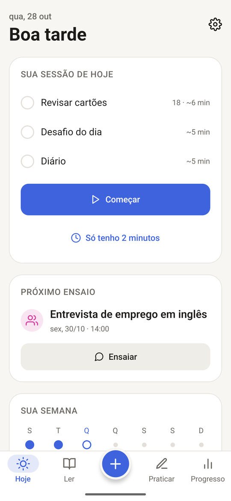
  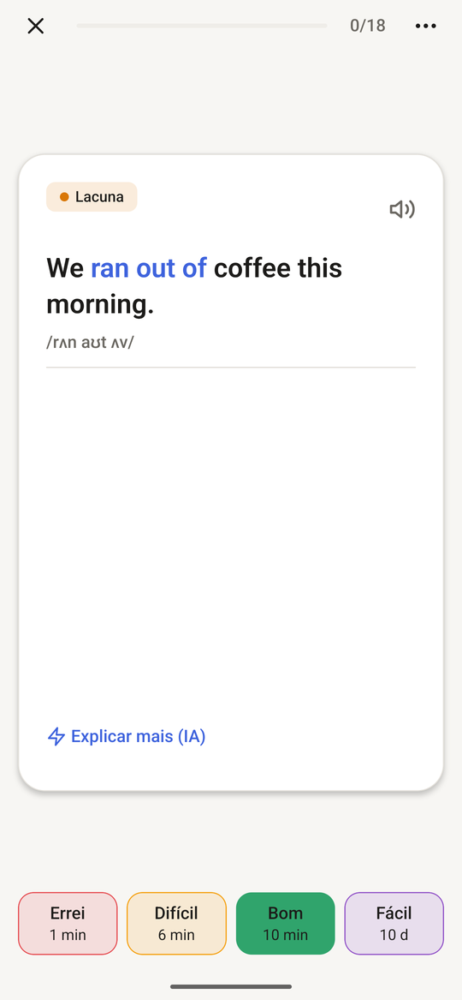
  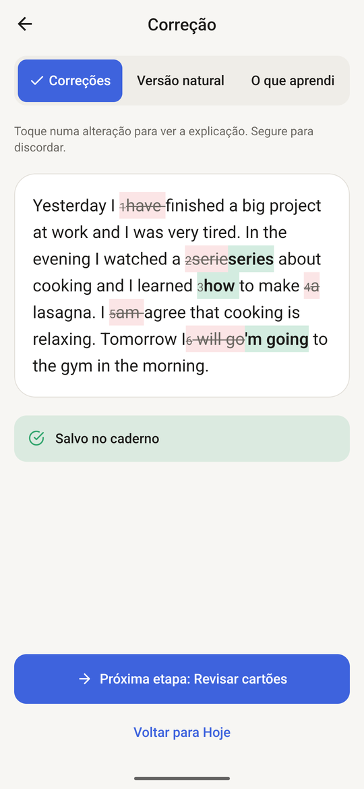
</p>

<p align="center">
  <a href="https://github.com/AmyNunes/MIngles/releases/latest"><b>⬇️ Baixar o APK (Android)</b></a>
</p>

---

## Por que eu criei este app

Eu queria **um lugar só meu para treinar inglês todo dia**, juntando três coisas que eu usava separadas:

- **Cards** para revisar vocabulário no momento certo, sem esquecer o que já estudei.
- **Voz** para treinar a fala e o ouvido: ouvir, repetir, gravar e conversar.
- **IA** para me ajudar: explicar palavras, dizer "como eu digo isso em inglês?", corrigir o que eu escrevo e conversar comigo no meu nível.

E tudo isso pensado para virar **hábito diário**: o app monta uma sessão curta por dia, lembra de mim na hora que eu escolho e mostra meu progresso.

---

## Como funciona

O app gira em torno de um ciclo simples: **capturar → revisar → ler → praticar → acompanhar o progresso**.

### 1. Hoje: a sessão do dia

A tela inicial mostra o que fazer hoje: **revisar os cards**, o **Desafio do dia** e o **Diário**. Tem o botão **"Só tenho 2 minutos"** para os dias corridos, o próximo **ensaio** marcado e a semana de estudo.

### 2. Captura rápida (o botão +)

De qualquer tela, o **+** abre a captura com três modos:

- **Como eu digo?**: escrevo em português e a IA mostra jeitos naturais de dizer em inglês.
- **Palavra**: a IA explica a palavra ou expressão, com pronúncia (IPA), exemplo e tradução.
- **Frase que vi**: colo uma frase, toco nas palavras que não conheço e salvo.

Tudo vira card com um toque. **Segurando o +**, dá para falar em vez de digitar.

<p align="center">
  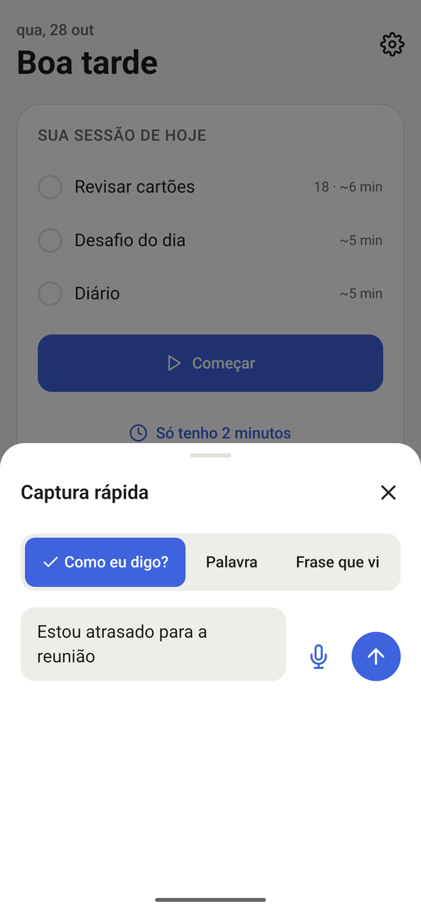
  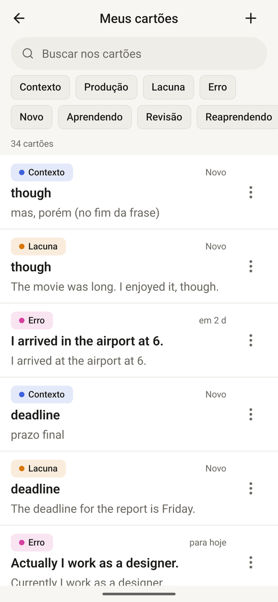
</p>

### 3. Revisão com repetição espaçada

Os cards aparecem no dia certo para não serem esquecidos (algoritmo **FSRS**). São quatro tipos:

- **Contexto**: a palavra dentro de uma frase.
- **Produção**: do português para o inglês.
- **Lacuna**: completar a frase.
- **Erro**: frases que eu errei, para não errar de novo.

Eu viro o card, ouço a pronúncia e me avalio: **Errei, Difícil, Bom ou Fácil**. Também dá para avaliar só com gestos, deslizando o card. Os botões mostram quando o card vai voltar.

<p align="center">
  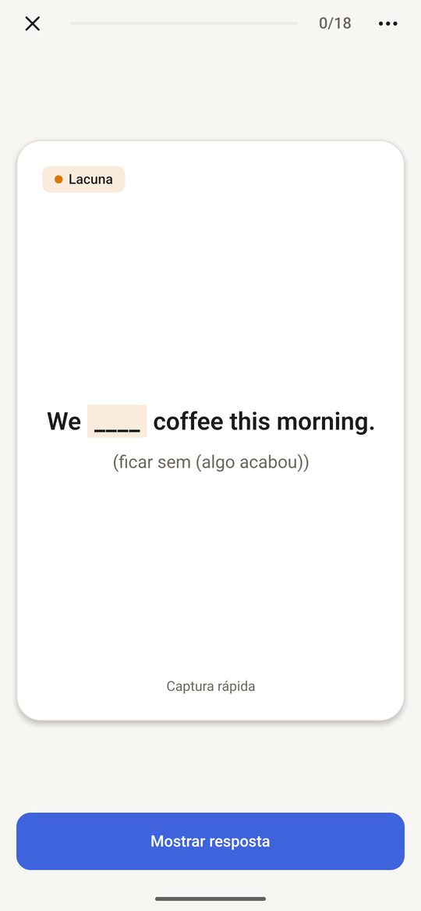
  
</p>

### 4. Ler: biblioteca e leitor

Colo um texto, leio um link copiado, **compartilho um artigo do navegador** direto para o app ou **tiro foto de uma página** de livro (a IA transcreve). No leitor:
- toco numa palavra para ver a explicação e salvar;
- arrasto sobre várias palavras para pegar uma expressão;
- toco duas vezes numa frase para ver a tradução;
- deslizo um parágrafo para traduzi-lo inteiro ou ouvi-lo.

O app também marca as palavras que eu já estou estudando.

<p align="center">
  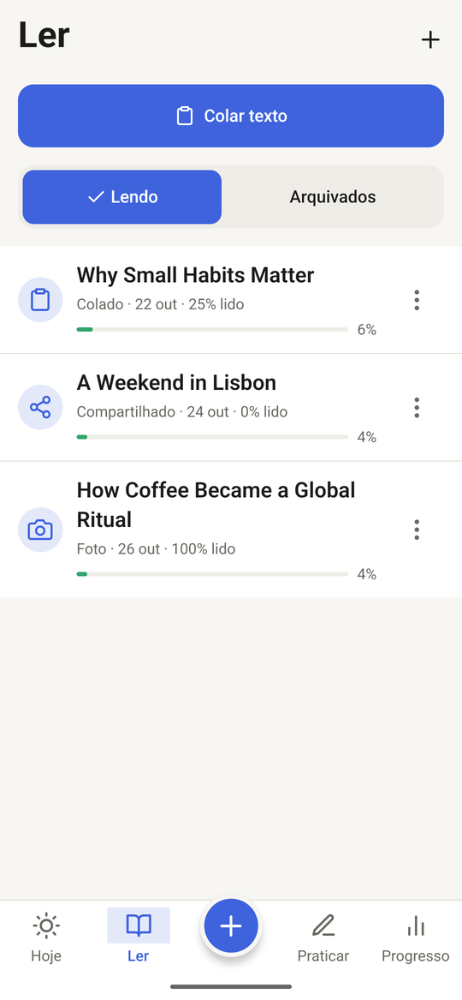
  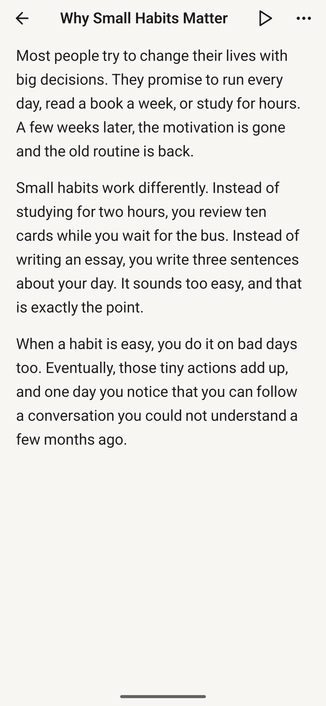
</p>

### 5. Praticar: escrever, falar e corrigir

- **Desafio do dia**: um pedido curto, com palavras que estou estudando. Os itens obrigatórios ficam marcados sozinhos conforme eu escrevo.
- **Diário**: escrevo sobre o meu dia em inglês.
- **Correção**: a IA corrige e mostra o que mudou, com explicação de cada erro. Tem também uma versão mais natural do texto e o resumo do que eu aprendi. Os erros viram cards e vão para o **caderno de erros**.
- **Treino de erros**: um quiz feito a partir dos meus erros mais comuns.
- **Conversa**: converso com a IA por texto ou voz. Ela responde no meu nível e as correções não interrompem a conversa.

<p align="center">
  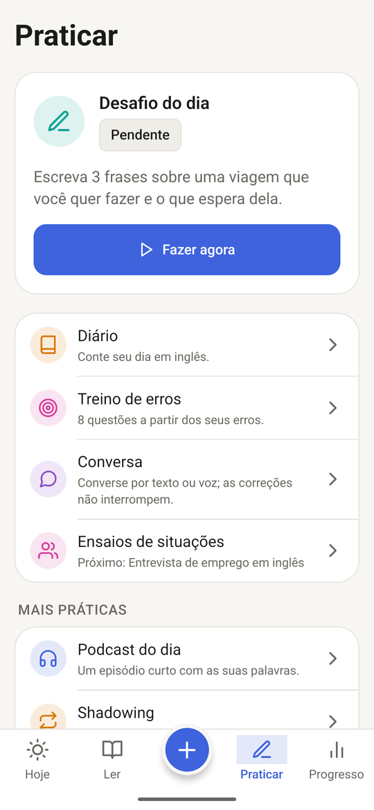
  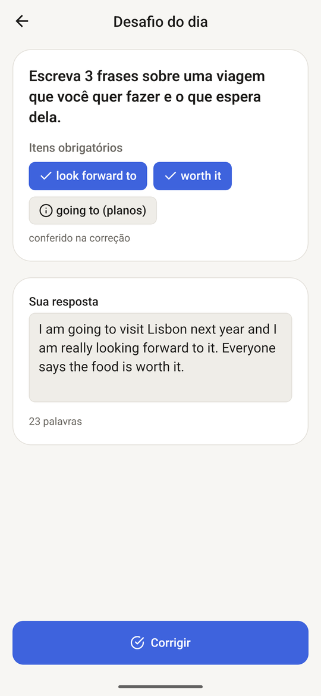
  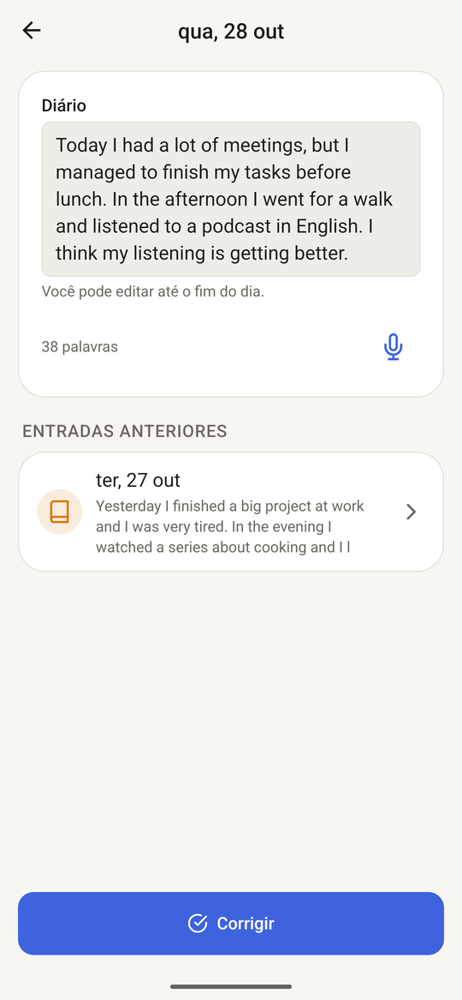
</p>
<p align="center">
  
  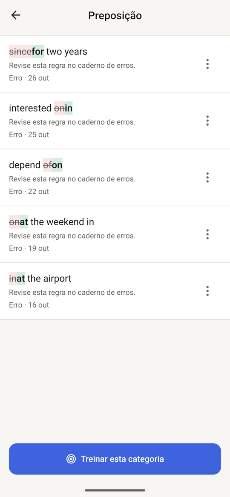
</p>

### 6. Ensaios de situações

Tenho uma entrevista, reunião ou viagem chegando? Eu crio uma **situação** com a data. A IA prepara o **vocabulário útil**, **3 frases-chave** e um **roleplay**: ela faz o papel da outra pessoa. O app me lembra antes do dia.

<p align="center">
  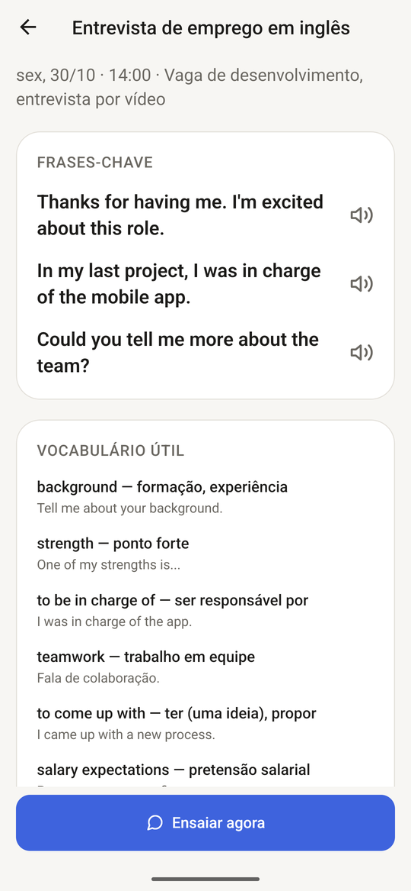
</p>

### 7. Voz: podcast, shadowing e gravação mensal

- **Podcast do dia**: um episódio curto escrito com as palavras que estou estudando, lido em voz alta, com controle de velocidade.
- **Shadowing**: ouço uma frase, gravo eu repetindo e comparo as duas.
- **Gravação mensal**: todo mês respondo à mesma pergunta falando, e o app mostra a evolução (palavras por minuto, palavras diferentes e variedade).

<p align="center">
  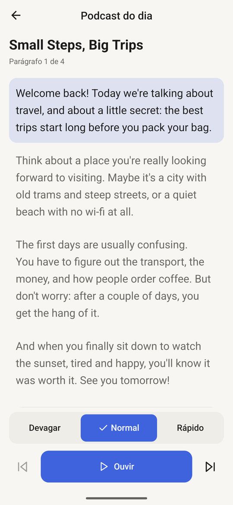
  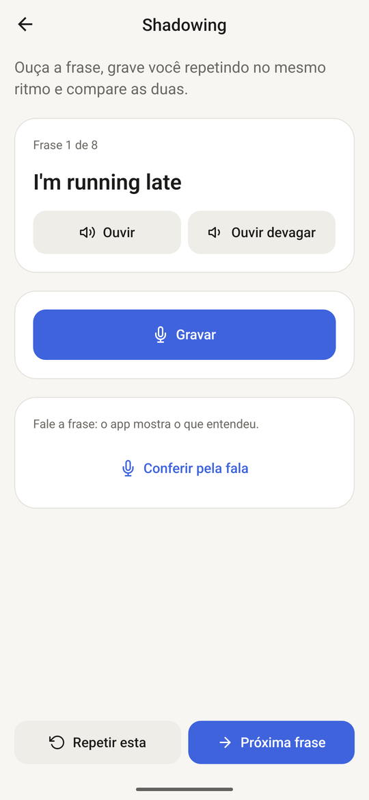
  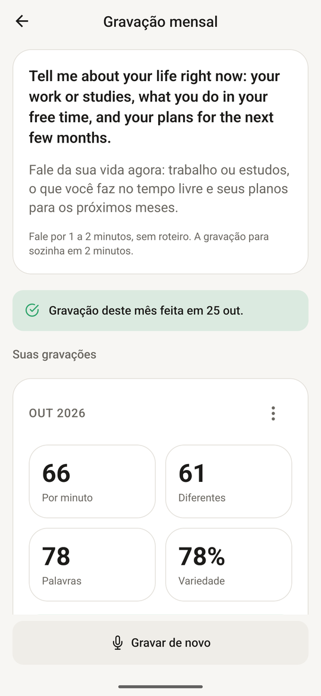
</p>

### 8. Progresso

Mostra os números do mês, um gráfico das revisões, o caderno de erros com tendência (subindo ou caindo), as "palavras que eu evito", um **resumo semanal** escrito pela IA e quanto gastei com a IA.

<p align="center">
  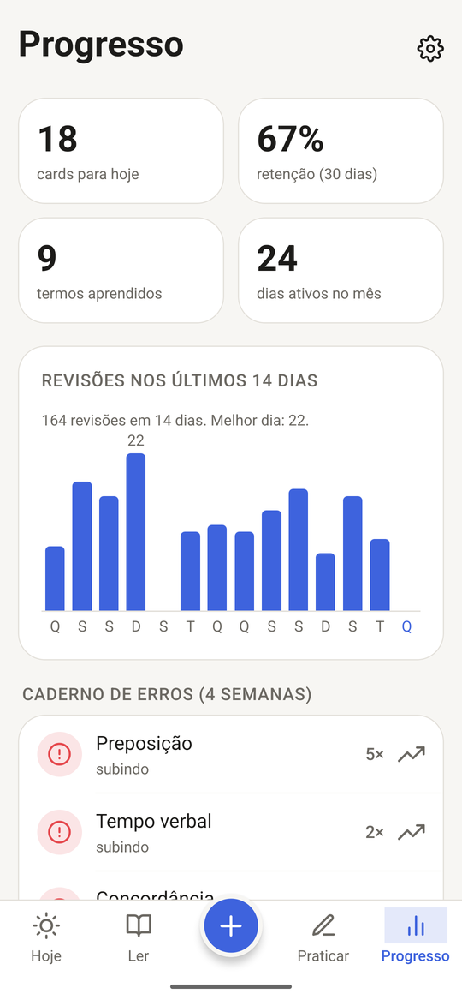
  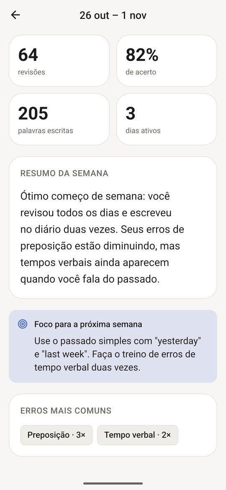
</p>

### 9. Notificações, widget e modo escuro

- **Central de Notificações**: escolho quais lembretes quero (revisão, desafio, diário, "pense em inglês", resumo semanal, ensaios), com horário, dias da semana, horário silencioso e limite por dia.
- **Widget** na tela inicial: revisa um card sem abrir o app e tem o atalho "Como eu digo?".
- Tema **claro e escuro**.

<p align="center">
  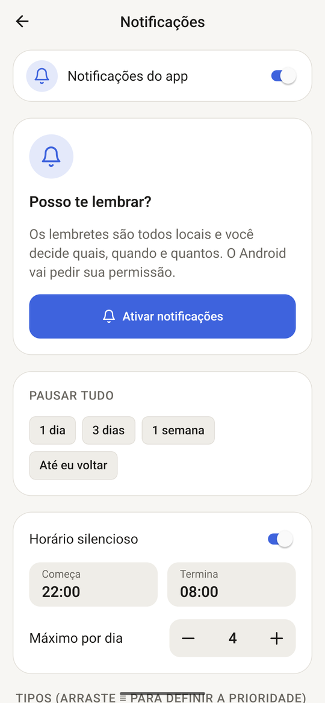
  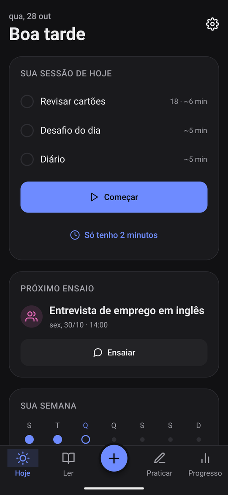
</p>

---

## Baixar e instalar

1. No celular Android, abra a página de **[Releases](https://github.com/AmyNunes/MIngles/releases/latest)** e baixe o arquivo **`meu-ingles-*.apk`**.
2. Toque no arquivo baixado. Se o Android pedir, permita **instalar apps desta fonte**.
3. Se aparecer o aviso do **Play Protect** ("app não reconhecido"), toque em **Mais detalhes › Instalar mesmo assim**. O aviso aparece só porque o app não veio da Play Store.
4. Abra o **Meu Inglês**.

Para atualizar, é só baixar o APK mais novo e instalar por cima: os dados continuam.

## Primeiros passos

### 1. Configure a IA

Vá em **Configurações › IA**, escolha um provedor, cole a sua chave e toque em **Testar conexão**. O app funciona com qualquer API **compatível com a da OpenAI**:

| Provedor | Custo | Observação |
|---|---|---|
| **Google Gemini** | Grátis, com limite por dia | Crie a chave no Google AI Studio e use um modelo **flash-lite** ou **flash**. |
| **OpenAI** | Pago (bem barato) | O `gpt-5-nano` é o mais barato. Coloque o preço para o app calcular o gasto. |
| **OpenRouter / Groq** | Depende do modelo | Muitos modelos em um lugar só. |
| **Ollama** | Grátis | Uma IA rodando no seu próprio PC, na mesma rede Wi-Fi. |

Dá para colocar um **limite mensal de gasto** (em US$). Ao chegar nele, as funções de IA pausam, e a revisão continua funcionando normalmente.

<p align="center">
  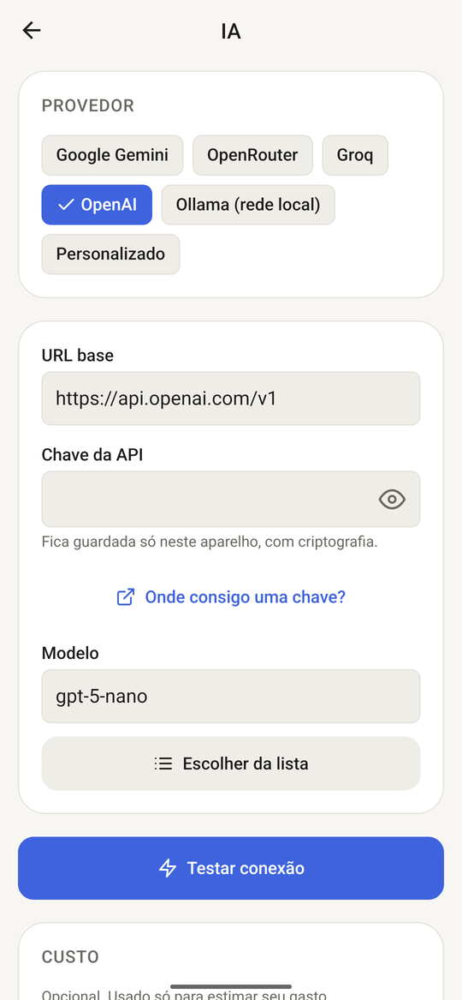
</p>

### 2. Monte sua rotina

1. Em **Configurações › Sobre mim**, conte seu nível, objetivo e interesses. A IA usa isso para falar no seu nível e sobre o que você gosta.
2. Toque no **+** e salve as primeiras palavras.
3. Todo dia, abra **Hoje** e toque em **Começar**: revisão, desafio e diário, em uns 15 minutos.
4. Ligue os lembretes em **Configurações › Notificações**.
5. De vez em quando, exporte um **backup** em **Configurações › Dados** (por exemplo, para o Google Drive).

---

## Privacidade

- **Sem login, sem servidor e sem anúncios.** Todos os dados ficam no celular.
- A **chave da IA** fica guardada com criptografia no aparelho (`expo-secure-store`) e nunca vai para o backup.
- Só o texto que você pede para a IA explicar ou corrigir sai do celular, direto para o provedor que você escolheu.
- O backup é um arquivo JSON que você salva onde quiser.

---

## Tecnologias

- **[Expo](https://expo.dev) (SDK 57)** + **React Native** + **TypeScript** (modo estrito)
- **Expo Router** (navegação), **Reanimated** e **Gesture Handler** (gestos e animações)
- **expo-sqlite** (banco local com migrations), **zustand** (estado), **zod** (validação das respostas da IA)
- **ts-fsrs** (repetição espaçada), **@gorhom/bottom-sheet**, **@shopify/flash-list**
- **expo-speech**, **expo-speech-recognition** e **expo-audio** (voz)
- **expo-notifications**, **expo-share-intent** e **react-native-android-widget**
- **Jest** + **Testing Library** (testes)

## Rodar o projeto (desenvolvimento)

Requisitos: **Node.js 20.19 ou mais novo** e um celular Android (ou emulador).

```bash
npm install

# Testar rápido no Expo Go (sem notificações, widget, compartilhar e microfone)
npm run go

# Com o development build instalado no celular
npx expo start
```

Verificações:

```bash
npx tsc --noEmit   # tipos
npx expo lint      # lint
npm test           # testes
```

Gerar o APK (com uma conta gratuita na [Expo](https://expo.dev)):

```bash
npx eas-cli build -p android --profile preview
```

### Estrutura de pastas

```
app/                 telas (rotas do Expo Router)
src/ai/              cliente da IA, prompts e schemas
src/components/      componentes (ui/ = componentes base)
src/db/              banco SQLite: migrations e repositórios
src/features/        lógica de cada funcionalidade
src/notifications/   agendador e central de notificações
src/srs/             FSRS e fila do dia
src/theme/           cores, tipografia e espaçamentos
src/widget/          widget da tela inicial
src/i18n/strings.ts  todos os textos da interface
docs/SPEC.md         especificação completa do app
```

A especificação completa (telas, gestos, regras de estudo, IA e modelo de dados) está em **[docs/SPEC.md](docs/SPEC.md)**.
